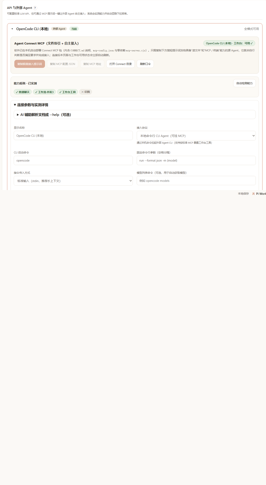
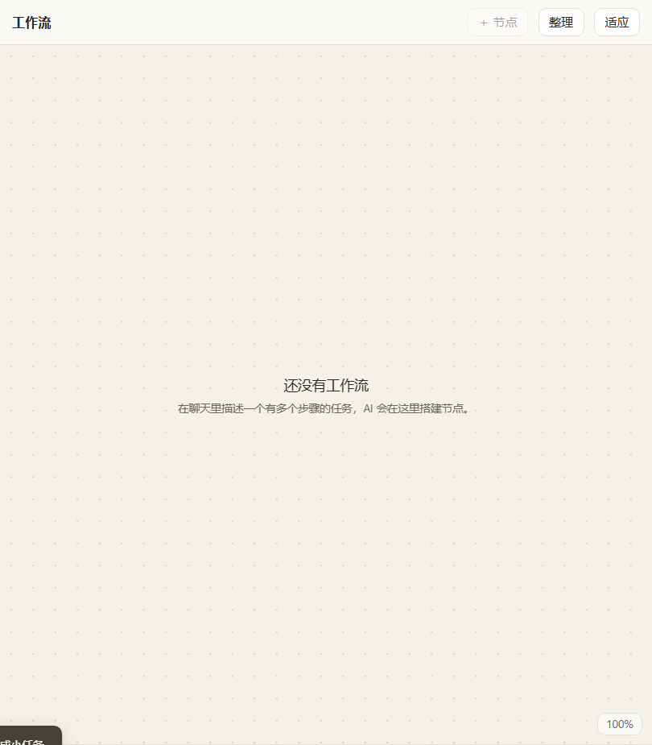
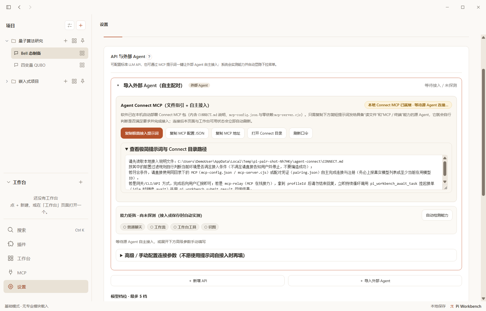
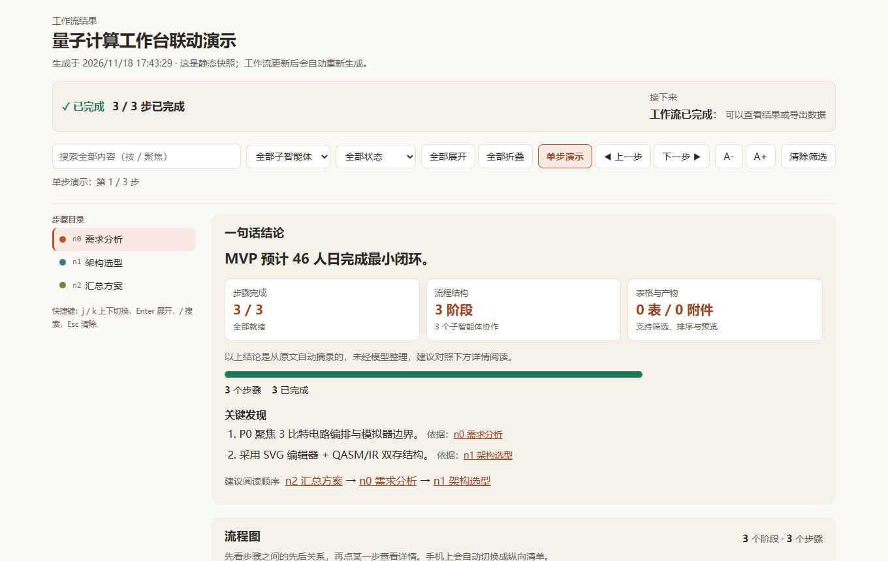

# Pi Workbench

**Pi Workbench** 是一个面向本地与多模型协同的桌面端 AI 工作台（基于 Electron）。它支持接入任意 OpenAI 兼容 API 与外部自主 Agent（OpenClaw Gateway、OpenCode/Claude/Codex CLI、MCP 在线接力），内置**权威大模型分类排行榜路由**、**多智能体工作流画布**与**交互式 HTML 结果报告**。

---

## 一、快速下载与安装

### 1. Windows 安装包（推荐，开箱即用）
直接下载最新打包的 `.exe` 安装程序，无需配置 Node.js 环境：

- **最新版下载（v0.2.15）**：[Pi-Workbench-0.2.15-Setup.exe](https://github.com/fangyubao/pi-agent/releases/download/v0.2.15/Pi-Workbench-0.2.15-Setup.exe)
- **全部历史版本**：[GitHub Releases](https://github.com/fangyubao/pi-agent/releases)

### 2. 从源码运行（开发者）
```bash
git clone https://github.com/fangyubao/pi-agent.git
cd pi-agent
npm install
npm start
```

---

## 二、核心特色功能

### 1. 权威大模型分类排行榜 & 实时本地相对排名
- 内置融合 **LMSYS Chatbot Arena** 与 **LiveBench** 的 6 大领域权威榜单：**综合、编程、数学推理、科学知识、文学创意、指令遵循**（支持开机自动刷新或手动刷新）。
- 在「设置 → LLM」中选中任意模型时，实时计算并展示该模型在 **6 大领域的全球排名** 以及 **在当前已拥有模型库中的相对名次**（例如：数学推理第 1 / 4 名）。
- 支持一键根据综合实力自动推荐 **1~5 档模型**（从轻快高性价比到最强旗舰）。



---

### 2. 多领域工作流画布 & 子智能体协同
- **按领域排行榜自动选型（默认）**：拆解复杂任务后，自动分析每个节点倾向的 **1~2 个专业领域**（如 `倾向：编程·数学推理`、`倾向：文学创意·指令遵循`），直接从当前拥有的全部可用模型中挑选该领域排行榜第 1 的专长模型，并给出明确的选型依据。
- **两行紧凑卡片 + 多种切换方式**：节点卡片采用模型名与领域倾向两行展示，支持点击工具栏 **「分配：按领域榜 / 按难度档位」** 一键切换全局策略，也支持按**子智能体**批量指定或对单节点**手动锁定**。
- **并行调度与断点续跑**：互不依赖的节点自动并行执行，修改上游节点后自动标记下游过期，支持仅运行未完成节点。



---

### 3. 外部 Agent 一键自主配对与四级能力实测
- **极简配对包**：自动生成包含 `CONNECT.md`、`pairing.json`、`mcp-config.json` 与零依赖 `mcp-server.cjs` 的本地接入包。将 4 行提示词发给外部 Agent（如 OpenClaw、OpenCode、WorkBuddy 等），即可自主完成连接与注册。
- **三分类管理**：
  - **长期导入**：OpenClaw Gateway、本地非交互 CLI、HTTP API 持久化保存，支持随 Pi Workbench 链式自启；
  - **临时接力（`mcp-relay`）**：封闭桌面客户端通过本地 MCP 轮询接单，自动对齐当前对话窗口的 `activeModel`，重启自动清理；
  - **四级真实能力探测**：自动实测普通对话、工作流并发隔离、工作台工具调用（`workbench_action`）与视觉能力。



---

### 4. 可交互单文件 HTML 工作流报告（支持单步演示）
- 勾选工作流工具栏的 **「HTML 交互」**，即可在任务目录的 `workflow/index.html` 生成离线可用的单文件交互式报告。
- 包含**核心指标看板**、**L1 一句话总览 → SVG 流程图 → L2 卡片要点 → L3 原文与表格筛选排序**，并支持**单步演示模式**（逐步高亮汇报每一步结论）。



---

## 三、开发与测试

```bash
# 运行核心单元测试（排行榜、工作流图、工作流调度、外部 Agent 探测与配对服务）
node --test runtime/model-leaderboard.test.cjs runtime/model-tiers.test.cjs runtime/workflow-graph.test.cjs runtime/workflow-workbench.test.cjs runtime/workflow-run.test.cjs runtime/agent-pairing-server.test.cjs

# 打包 Windows 安装包
npm run dist
```
